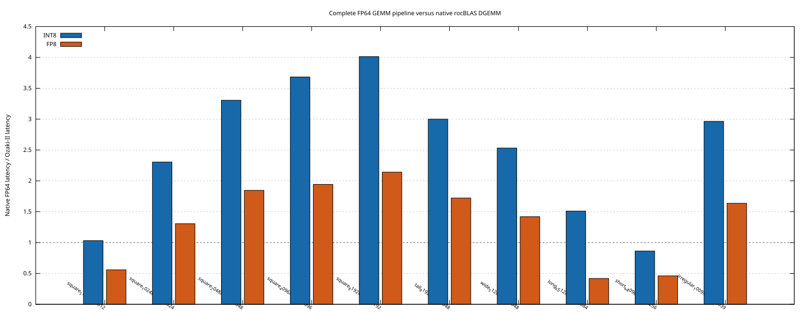
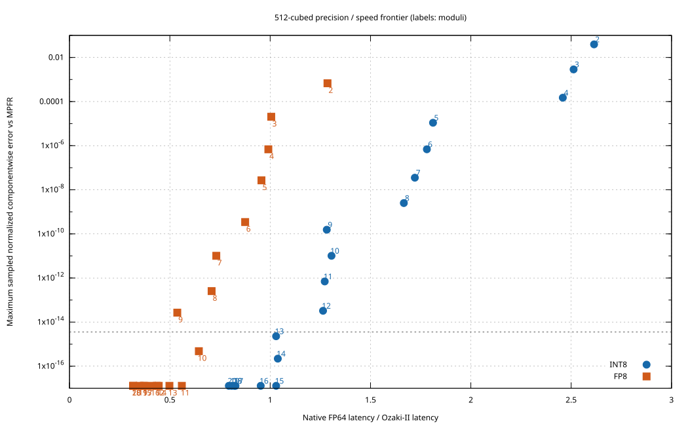

# RX 9070 XT Ozaki-II benchmark

The reported latency covers exponent analysis, input packing, the complete Ozaki-II pipeline, and the FP64 epilogue. Native FP64 is direct rocBLAS DGEMM on the same inputs. Each row uses five warmups and 30 HIP-event samples, with calls repeated to target at least 100 ms per sample. Native baselines are measured separately for INT8 and FP8 runs.

Inputs are deterministic uniform FP64, seed 42, with alpha=1 and beta=0. INT8 uses 15 moduli and FP8 11, fast scaling, and the selected variants from [tuning.csv](tuning.csv). The maximum normalized error and ULP statistics compare sampled outputs with a 256-bit MPFR reference; all outputs are checked when there are at most 4096, otherwise 256 positions are sampled.

| Family and M×N×K | Native ms / TFLOP/s (INT8 / FP8 run) | INT8 ms (speedup) | FP8 ms (speedup) | INT8 / FP8 sampled normalized error |
|---|---:|---:|---:|---:|
| square 512×512×512 | 0.338 / 0.79; 0.340 / 0.79 | 0.328 (1.03×) | 0.609 (0.56×) | 1.29e-17 / 1.29e-17 |
| square 1024×1024×1024 | 2.630 / 0.82; 2.650 / 0.81 | 1.141 (2.30×) | 2.029 (1.31×) | 6.76e-18 / 6.76e-18 |
| square 2048×2048×2048 | 22.362 / 0.77; 22.374 / 0.77 | 6.765 (3.31×) | 12.121 (1.85×) | 6.6e-18 / 6.6e-18 |
| square 4096×4096×4096 | 172.379 / 0.80; 169.042 / 0.81 | 46.800 (3.68×) | 87.021 (1.94×) | 3.4e-18 / 3.4e-18 |
| square 8192×8192×8192 | 1344.777 / 0.82; 1345.317 / 0.82 | 335.086 (4.01×) | 628.313 (2.14×) | 3.32e-18 / 3.32e-18 |
| tall 8192×512×2048 | 22.165 / 0.78; 22.040 / 0.78 | 7.388 (3.00×) | 12.800 (1.72×) | 6.3e-18 / 6.3e-18 |
| wide 512×8192×2048 | 22.113 / 0.78; 22.082 / 0.78 | 8.735 (2.53×) | 15.555 (1.42×) | 6.7e-18 / 6.7e-18 |
| long_k 512×512×16384 | 10.860 / 0.79; 10.820 / 0.79 | 7.190 (1.51×) | 25.857 (0.42×) | 1.71e-18 / 1.15e-17 |
| short_k 4096×4096×256 | 10.478 / 0.82; 10.496 / 0.82 | 12.142 (0.86×) | 22.771 (0.46×) | 1.08e-17 / 1.08e-17 |
| irregular 1009×1537×2039 | 9.140 / 0.69; 9.081 / 0.70 | 3.083 (2.96×) | 5.549 (1.64×) | 6.56e-18 / 6.56e-18 |

† Failed the stated sampled precision criterion.

Equal-family geometric means (the five square sizes first count as one family):
- INT8: **2.06×** native FP64.
- FP8: **1.01×** native FP64.

## Precision / performance sweep

At 512³, these are the fastest configurations in this campaign satisfying the sampled precision criterion. All moduli counts and failures are in [results.csv](results.csv).

| Backend | Fastest passing count | Time ms | Speedup | Max sampled normalized error | Max absolute error (emulated / native) | Median / 95th / max ULP |
|---|---:|---:|---:|---:|---:|---:|
| INT8 | 14 | 0.328 | 1.04× | 2.2e-16 | 2.74e-14 / 2.42e-14 | 7 / 41 / 262 |
| FP8 | 10 | 0.525 | 0.64× | 4.8e-16 | 6.54e-14 / 2.42e-14 | 17 / 84 / 853 |

## Raw WMMA product

These separate device-resident 1024³ modular-product measurements exclude input conversion, CRT, and the FP64 epilogue. They are not FP64 GEMM throughput.

| Backend | Median ms | Raw TOP/s or TFLOP/s | Max sampled integer error |
|---|---:|---:|---:|
| INT8 | 0.0737 | 29.14 | 0 |
| FP8 | 0.0731 | 29.38 | 0 |

## Numerical stress

The criterion is `max(4 * native maximum normalized error, 32 * 2^-53)` for each case. Subnormal outputs have an unavoidable quantization floor, so the native FP64 error term is important.

| Input | Scaling | INT8 count | INT8 error / pass | FP8 count | FP8 error / pass |
|---|---|---:|---:|---:|---:|
| wide | fast | 15 | 2.85e-10 / no | 11 | 2.85e-10 / no |
| wide | fast | 20 | 3.76e-16 / yes | 20 | 9.9e-17 / yes |
| wide | accurate | 15 | 9.74e-11 / no | 11 | 9.74e-11 / no |
| wide | accurate | 20 | 5.2e-16 / yes | 20 | 9.9e-17 / yes |
| cancellation | fast | 15 | 1.9e-18 / yes | 11 | 4.03e-18 / yes |
| cancellation | fast | 20 | 1.14e-31 / yes | 20 | 1.14e-31 / yes |
| cancellation | accurate | 15 | 1.9e-18 / yes | 11 | 4.03e-18 / yes |
| cancellation | accurate | 20 | 1.14e-31 / yes | 20 | 1.14e-31 / yes |
| zero | fast | 15 | 0 / yes | 11 | 0 / yes |
| zero | fast | 20 | 0 / yes | 20 | 0 / yes |
| zero | accurate | 15 | 0 / yes | 11 | 0 / yes |
| zero | accurate | 20 | 0 / yes | 20 | 0 / yes |
| subnormal-input | fast | 15 | 5.74e-17 / yes | 11 | 5.74e-17 / yes |
| subnormal-input | fast | 20 | 5.74e-17 / yes | 20 | 5.74e-17 / yes |
| subnormal-input | accurate | 15 | 5.74e-17 / yes | 11 | 5.74e-17 / yes |
| subnormal-input | accurate | 20 | 5.74e-17 / yes | 20 | 5.74e-17 / yes |
| subnormal-output | fast | 15 | 2.6e-06 / yes | 11 | 2.6e-06 / yes |
| subnormal-output | fast | 20 | 2.6e-06 / yes | 20 | 2.6e-06 / yes |
| subnormal-output | accurate | 15 | 2.6e-06 / yes | 11 | 2.6e-06 / yes |
| subnormal-output | accurate | 20 | 2.6e-06 / yes | 20 | 2.6e-06 / yes |
| huge | fast | 15 | 3e-17 / yes | 11 | 3e-17 / yes |
| huge | fast | 20 | 3e-17 / yes | 20 | 3e-17 / yes |
| huge | accurate | 15 | 3e-17 / yes | 11 | 3e-17 / yes |
| huge | accurate | 20 | 3e-17 / yes | 20 | 3e-17 / yes |

## Internal phase profile

These medians come from a separate instrumented build with synchronization. They cover GEMMul8 internals on normalized uniform inputs; outer exponent scanning, input staging, and the final public-API epilogue are excluded. They should not be summed or compared directly with the headline event timings.

| Backend | M=N=K | Scaling / packing ms | WMMA ms | Modular reduction ms | CRT / rescaling ms |
|---|---:|---:|---:|---:|---:|
| INT8 | 1024 | 0.165 | 0.788 | 0.070 | 0.076 |
| FP8 | 1024 | 0.207 | 1.408 | 0.092 | 0.069 |
| INT8 | 2048 | 0.649 | 4.287 | 0.350 | 0.247 |
| FP8 | 2048 | 1.211 | 9.009 | 0.673 | 0.344 |

## Conditions and limits

GPU: RX 9070 XT, gfx1201, 64 CUs, 16 GB. [Environment and telemetry](benchmark_environment.txt) records the compiler, ROCm, repository revision, and sampled telemetry. Clocks were not locked. AMD SMI reported the GPU as throttled during the 8192³ run, but did not report the reason. These measurements therefore describe this run and should not be treated as an architectural peak.

WMMA ISA and resource checks: Both selected variant 27 kernels have 192 VGPRs, 16 KiB LDS, and two reported VGPR spills (12 bytes of private storage per thread). Their code objects contain the expected INT8/FP8 WMMA instructions. The exact rocBLAS DGEMM dispatch was traced to a double-precision code object containing `v_fma_f64`.

The accuracy sweep and large-matrix checks are sampled, and fast/accurate scaling at a fixed modulus count does not guarantee FP64-quality componentwise error for all finite matrices. K-block boundaries, padded output panels, scalar cases, and subnormal cases have separate correctness tests; no performance estimate extrapolates beyond the measured shapes.

Reproduce with `make -C rdna4/gemmmul8 -j8`, `make -C rdna4/gemmmul8 test`, `python3 rdna4/gemmmul8/benchmark_campaign.py`, `python3 rdna4/gemmmul8/plot_results.py`, and `python3 rdna4/gemmmul8/report_results.py`.
